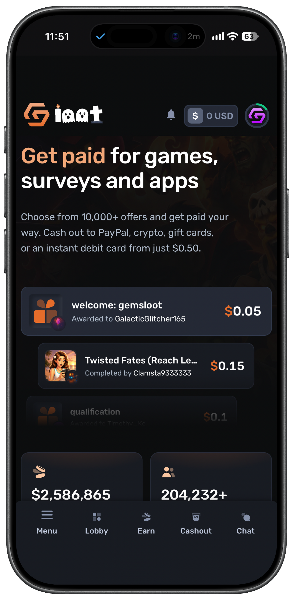
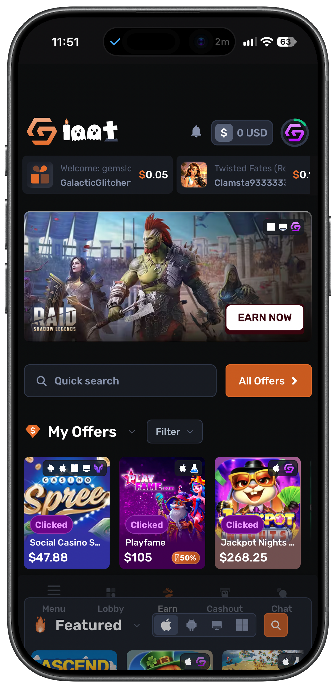
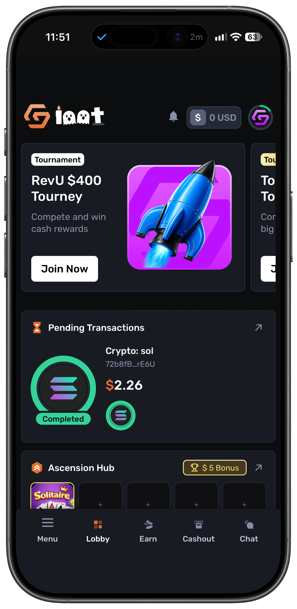
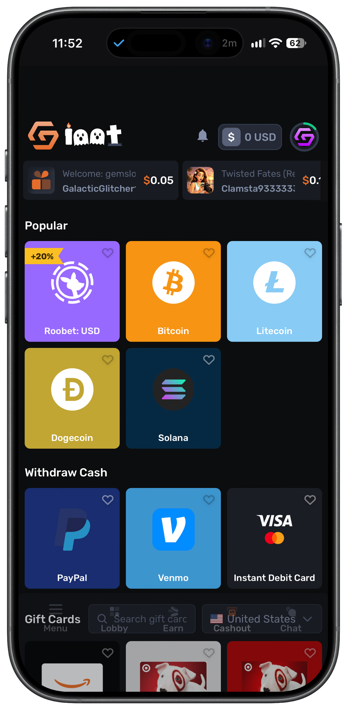
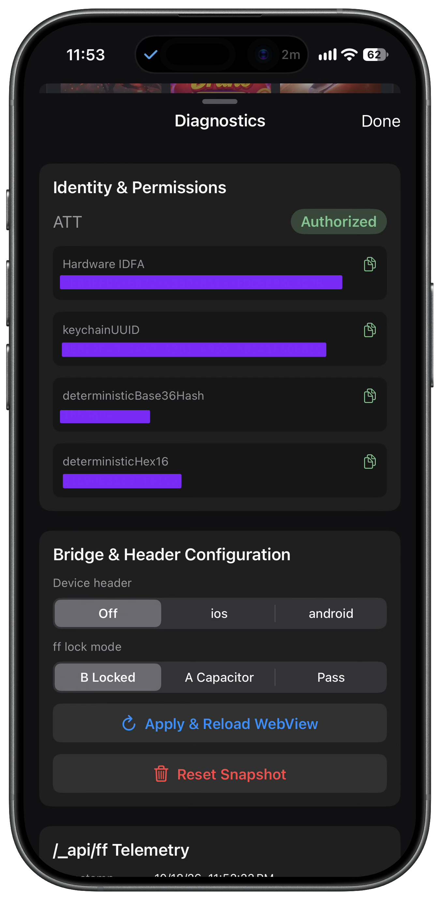
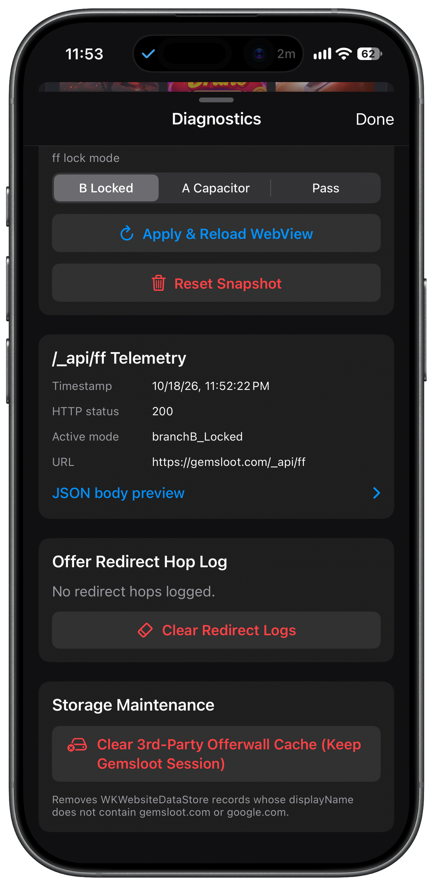

<div align="center">

# Gemsloot iOS

<p align="center">
  <b>Unofficial native iOS wrapper & attribution bridge for <a href="https://gemsloot.com">gemsloot.com</a></b>
</p>

<p align="center">
  
  
  
  
  
</p>

</div>

---

> **Disclaimer:** This is **not** the official Gemsloot app. The official Android product is a Capacitor hybrid that ships a build-time `is_android: true` web bundle. This project is an independent native iOS client engineered to solve attribution and reward tracking failures at the native runtime level.

---

## 📱 App Preview

<div align="center">
  <p align="center">
    
    &nbsp;
    
    &nbsp;
    
    &nbsp;
    
  </p>
  <p align="center">
    <sub><b>Core Experience:</b> Home Shell &nbsp;•&nbsp; Earn & Offerwalls &nbsp;•&nbsp; Game Lobby &nbsp;•&nbsp; Cashout Flow</sub>
  </p>
</div>

<br />

<div align="center">
  <h4>🛠️ On-Device Diagnostics HUD (3-Finger Tap or Shake)</h4>
  <p align="center">
    
    &nbsp;&nbsp;&nbsp;&nbsp;
    
  </p>
  <p align="center">
    <sub><b>Left:</b> ATT Status, Copyable IDs & Bridge Lock Modes &nbsp;&nbsp;|&nbsp;&nbsp; <b>Right:</b> Live <code>/_api/ff</code> Payload Telemetry, Redirect Hops & Cache Controls</sub>
  </p>
</div>

---

## 💡 Why This Exists

Standard mobile browsers on iOS (Safari, Chrome via WebKit) break reward offer attribution due to cross-site cookie blocking, dynamic anti-fingerprinting noise injection, and aggressive redirect-chain stripping. 

**Gemsloot iOS** resolves those failure vectors at the native runtime level:
* **Full-Screen Native Shell:** Loads `https://gemsloot.com` in `WKWebsiteDataStore.default()` with a `#101012` background, native pull-to-refresh, and back/forward swipe gestures.
* **Fixed Safari Mobile UA:** Forces offerwalls to serve iOS App Store inventory instead of Google Play links.
* **Injected `fetch`/`XHR` Bridge:** Intercepts `/_api/ff` requests to lock device fingerprint schemas and optionally inject `Device` headers.
* **True Popup Lifecycle:** Preserves `window.opener` across child WebViews so OAuth and offerwall tracking sheets never break or strand the main view.
* **Native App Store Handoff:** Intercepts `apps.apple.com`, `itunes.apple.com`, and `itms-apps://` schemes to launch the system App Store cleanly.
* **Live Diagnostics HUD:** Provides real-time visibility into tracking IDs, bridge modes, payload bodies, and redirect hops.

---

## 🚫 What This App Is Not

* **Not a Capacitor port:** Does not reimplement Gemsloot's Android Capacitor plugins (`Playtime` / Adjoe, Install Referrer, push notifications, etc.). Those remain exclusive to Android's `Il.is_android` path.
* **Not a general-purpose multi-tab browser:** Secondary windows are strictly managed tracker and OAuth sheets.
* **Not signed for App Store distribution:** CI outputs an **unsigned** `Gemsloot-iOS.ipa` on purpose (no Apple signing certificates stored in GitHub Actions). Sign and sideload it with your own provisioning setup.

---

## 🔍 Android Recon (Why the Bridge Exists)

The official Android APK is a Capacitor wrapper where feature branching is controlled via a **build-time** `Il.is_android` flag rather than runtime `Capacitor.isNativePlatform()` checks (which have zero call sites in the web bundle).

Relevant `/_api/ff` payload architectures:

* **Branch A (Android Capacitor):**
  * `hash`: `Device.getId().identifier` (`Settings.Secure.ANDROID_ID`, ~16 hex chars)
  * `data`: Full `Device.getInfo()` payload
  * `formated_data`: `{ browser, browser_ver, os, timezone, language }`
  * Header: `Device: android`
* **Branch B (Browser / Live Web Bundle):**
  * `hash`: `MurmurHash3_x86_32(JSON.stringify(fingerprint), 0).toString(36)`
  * `data`: Browser fingerprint collectors
  * `formated_data`: Expanded browser metadata object

Loading the live site inside a standard `WKWebView` defaults to **Branch B**, where dynamic WebKit anti-fingerprinting noise mutates the hash across sessions. `WebViewBridge` intercepts and locks this payload so your device identity remains rock-solid. *(See Phase 1 recon and `step-1-ff-payload` docs for full payload traces).*

---

## 🔐 Device Identity & `/_api/ff` Lock Modes

### Deterministic IDs (Single Keychain Seed)
A single master UUID seed generated once and persisted in the iOS Keychain drives three deterministic identifiers:

* **`keychainUUID`** (`UUID v4 string`) — Master seed stored in Keychain.
* **`deterministicBase36Hash`** (`Base-36 uint32`) — `MurmurHash3_x86_32(seed)` matching the exact output shape of Branch B's `ZB()` hash function.
* **`deterministicHex16`** (`16-char lowercase hex`) — First 8 bytes of `SHA-256(seed UTF-8)`, matching `ANDROID_ID` length.
* **Hardware IDFA** — Sourced from `ASIdentifierManager` once ATT is authorized (returns zeros/unavailable until granted).

### Bridge Lock Modes
Configured via `AppState.ffLockMode` (toggleable in the HUD). The injected document-start script patches both `window.fetch` and `XMLHttpRequest` for `gemsloot.com/_api`, ensuring `credentials: 'include'` is always enforced.

* **`branchB_Locked` (Default):** Retains the Branch B schema. On the first POST to `/_api/ff`, replaces `hash` with `deterministicBase36Hash`, persists the exact `JSON.stringify({ hash, data, formated_data })` snapshot, and replays that exact string on every subsequent request.
* **`branchA_Capacitor`:** Replaces the POST body with a Capacitor-shaped payload using `deterministicHex16` as the `hash`.
* **`passthrough`:** Leaves `/_api/ff` bodies untouched.

> **Note:** Optional `Device: ios` or `Device: android` headers can be toggled via `deviceHeaderMode` (defaults to `off`). Tapping **Reset Snapshot** in the HUD clears the persisted Mode 1 JSON so a fresh fingerprint can be captured.

---

## 🌐 Popups, OAuth & Offerwall Routing

To prevent broken OAuth logins and dead tracking links, `webView(_:createWebViewWith:for:windowFeatures:)` executes a strict three-step handoff:
1. Instantiates `TrackerRedirectViewController` using the **exact** `WKWebViewConfiguration` passed in by WebKit.
2. Presents the controller as a modal sheet.
3. **Returns** that child controller's `webView` instance back to WebKit.

*(Returning `nil` or forcing navigation into the main WebView severs `window.opener.postMessage("oauth_done")` and strands the main view on blank tracking URLs).*

### Child Sheet Navigation Behavior
* **Redirect Telemetry:** Logs every hop into `redirectLogs` (capped at 50 entries).
* **MMP IDFA Injection:** On known Mobile Measurement Partner (MMP) and offerwall hosts, automatically populates empty or all-zero `idfa`, `ios_idfa`, `advertising_id`, and `gaid` query parameters when a valid hardware IDFA is available.
* **App Store Handoff:** Intercepts `apps.apple.com`, `itunes.apple.com`, and `itms-apps(s)://` URLs, cancels the in-app load, triggers `UIApplication.shared.open`, and auto-dismisses the popup sheet after 0.6s.
* **OAuth Auto-Close:** Implements `webViewDidClose` to cleanly dismiss the sheet when an OAuth provider fires `window.close()`.
* **External Schemes:** Main WebView routes App Store links, `mailto:`, `tg://`, and `discord://` directly to their native system handlers.

---

## 🛠️ Diagnostics HUD

Trigger the HUD anytime via a **3-finger tap** or **device shake**.

* **ATT & Identity:** View current ATT authorization status (with a manual **Request ATT Permission** trigger if `.notDetermined`) and one-tap copy for all deterministic IDs and hardware IDFA.
* **Bridge Controls:** Live pickers for `deviceHeaderMode` and `ffLockMode`. Tapping **Apply & Reload** rebuilds the document-start `WKUserScript` from `AppState.bridgeConfig` and performs a hard reload of `https://gemsloot.com`.
* **Payload Inspector:** Displays the status code and full JSON body of the last intercepted `/_api/ff` request posted via `gemslootBridge`.
* **Redirect Log:** Inspect the chronological chain of offerwall/MMP hops.
* **Selective Cache Purge:** Clears third-party `WKWebsiteDataStore` records while preserving active session data for `gemsloot.com` and `google.com`.

---

## 🗂️ Project Layout

```text
project.yml                 # XcodeGen spec — single source of truth for the project
scripts/build_ipa.sh        # Builds unsigned Release Gemsloot-iOS.ipa
.github/workflows/          # CI workflow (build-ipa.yml)
Gemsloot/
  ├── AppDelegate.swift
  ├── SceneDelegate.swift
  ├── Info.plist
  ├── Assets.xcassets/
  │   └── AppIcon.appiconset/
  ├── Helpers/              # KeychainHelper, MurmurHash3, AppState
  ├── Bridge/               # WebViewBridge.swift
  ├── WebView/              # Main VC, TrackerRedirect, IDFAURLRewriter
  └── Diagnostics/          # TrackingDiagnosticsSheet.swift
```

*`*.xcodeproj` is generated dynamically by XcodeGen and is gitignored—do not hand-edit it.*

---

## 🚀 Build & Installation

### 1. GitHub Actions CI (Recommended)
Pushing to `main`, opening a PR, or triggering `workflow_dispatch` runs the build pipeline on `macos-15`, installs XcodeGen, executes `./scripts/build_ipa.sh`, and uploads the **`Gemsloot-iOS-unsigned-ipa`** artifact containing `Gemsloot-iOS.ipa`.

### 2. Local Build (macOS + Xcode)
```bash
brew install xcodegen   # First-time setup
./scripts/build_ipa.sh
# Output -> build/Gemsloot-iOS.ipa
```
Code signing is explicitly disabled in the build script (`CODE_SIGNING_ALLOWED=NO`, empty `CODE_SIGN_IDENTITY`). Sign and install `Gemsloot-iOS.ipa` using your preferred on-device signer or sideloading tool (KSign, Feather, ESign, LiveContainer, AltStore, SideStore, TrollStore, or Xcode).

### 3. Generate Xcode Project Only
```bash
xcodegen generate
open Gemsloot.xcodeproj
```

---

## 🔒 Info.plist & Privacy Configuration

* **`NSUserTrackingUsageDescription`:** Required for ATT prompt (+1s delay after `viewDidAppear`).
* **`NSLocationWhenInUseUsageDescription`:** Supports `WhenInUse` WebView geolocation requests.
* **`ITSAppUsesNonExemptEncryption`:** Set to `false`.
* **No `WKAppBoundDomains`:** Intentionally omitted so third-party offerwall iframes and cross-domain trackers are never blocked by WebKit domain locks.
* **Target Specs:** iOS 16.0+ deployment target, Swift 5.9, Portrait orientation locked.

---

## 📜 License & Affiliation

Unofficial independent client. Not affiliated with, endorsed by, or sponsored by Gemsloot. Use at your own risk and ensure compliance with Gemsloot's terms of service and applicable offerwall guidelines.
